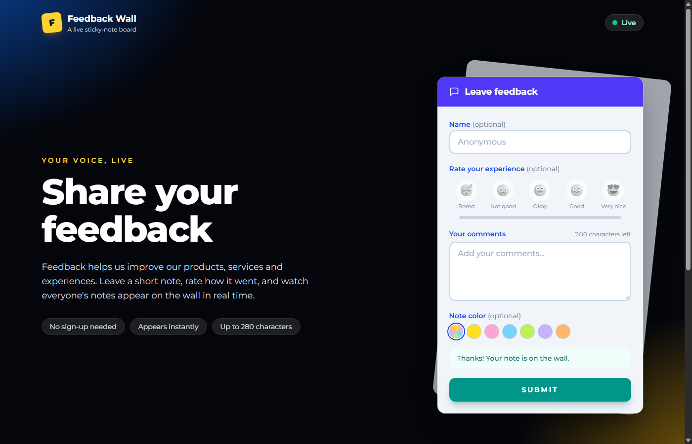
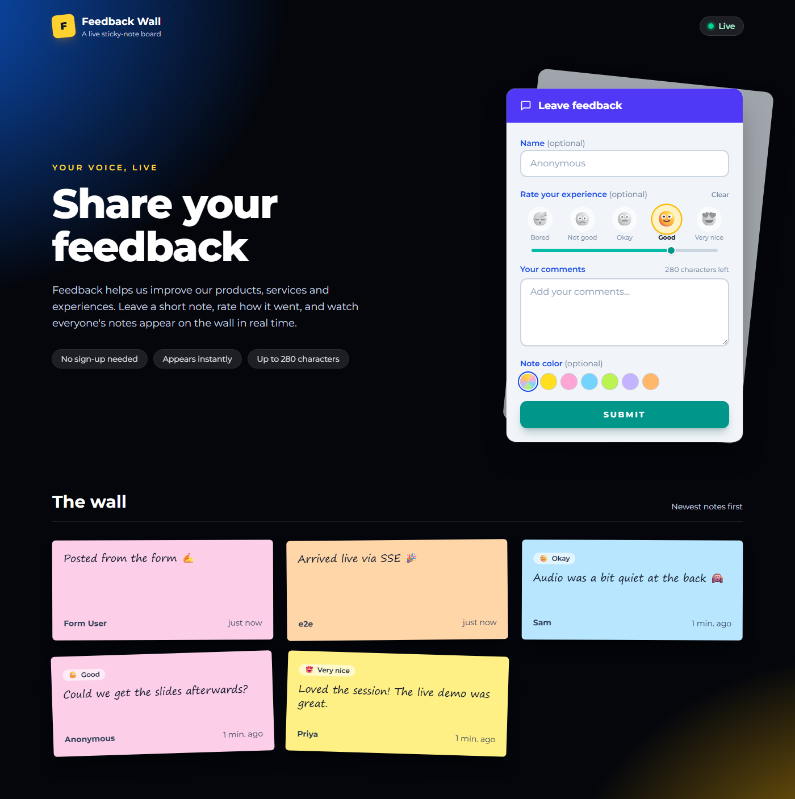

# Feedback Wall

A public, real-time "sticky-note board": anyone can post a short feedback note — with an optional 1–5 emoji experience rating — and everyone sees it appear live on a shared wall. No sign-up needed.



## Highlights

- **Post a note** — message (1–280 characters), optional name, optional note color, optional emoji rating (Bored → Very nice).
- **Live wall** — new notes appear instantly for every viewer via Server-Sent Events, with automatic reconnect and a Live / Reconnecting indicator.
- **Safe by default** — server-side validation with shared Zod schemas, plain-text rendering (no HTML injection), 5 posts/minute/IP rate limit, security headers.
- **Simple to run** — one Node.js process and one SQLite file; no external services.



## Tech stack

TypeScript everywhere · React 19 + Vite + Tailwind CSS v4 · Express 5 · Server-Sent Events · SQLite (better-sqlite3 + Drizzle ORM) · Zod · Vitest + Supertest · npm workspaces (`client/`, `server/`, `shared/`).

## Run it locally

Requires Node.js 20+.

```bash
npm install
npm run dev        # client on http://localhost:5173, API on :3001
```

Other commands:

```bash
npm test           # 42 automated tests (server + client)
npm run lint       # ESLint
npm run build      # production build
npm start          # production server (serves API + built client)
```

## Documentation

| Document | What's in it |
|---|---|
| [Product & Technical Documentation](docs/PRODUCT_AND_TECHNICAL_DOCUMENTATION.md) | PM pack: PRD, user stories, workflows, technical design, QA, deployment, roadmap and risks |
| [PRODUCT.md](docs/PRODUCT.md) | Features, scope and non-goals |
| [ARCHITECTURE.md](docs/ARCHITECTURE.md) | Folder structure, data flow, real-time design, deployment |
| [API.md](docs/API.md) | Endpoints, payloads, SSE events, error format |
| [DATABASE.md](docs/DATABASE.md) | Schema and migrations |
| [SECURITY.md](docs/SECURITY.md) | Validation, rate limiting, headers, known gaps |
| [TECH_STACK.md](docs/TECH_STACK.md) | Libraries and why they were chosen |
| [CONVENTIONS.md](docs/CONVENTIONS.md) | Coding conventions |
| [decisions/](docs/decisions/) | Architecture decision records |
| [CHANGELOG.md](docs/CHANGELOG.md) | Feature history |
| [CLAUDE.md](CLAUDE.md) | Project context file used to guide AI-assisted development |

## How it was built

The product was specified first — product scope, API contract, data model, security rules and coding conventions written as docs (`CLAUDE.md` + `docs/`) — and then implemented with Claude Code against that specification, with the docs kept in sync as features changed (for example, adding the emoji rating went through a schema migration, API update and doc updates in the same change).
