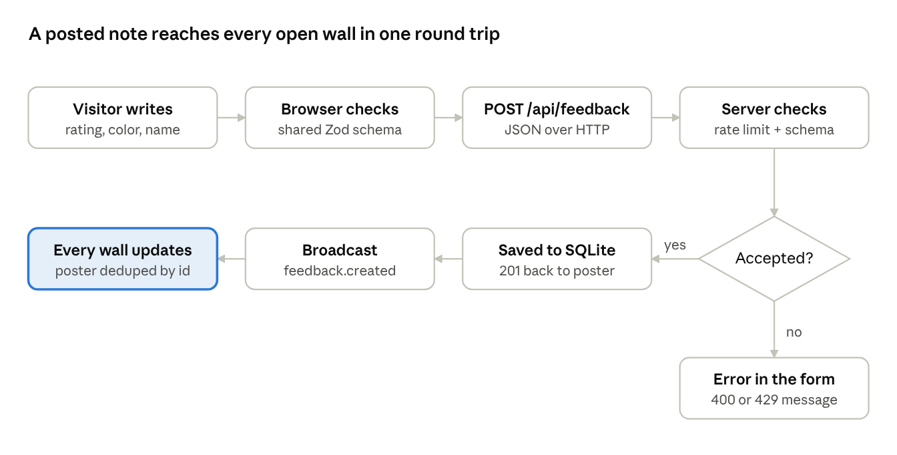
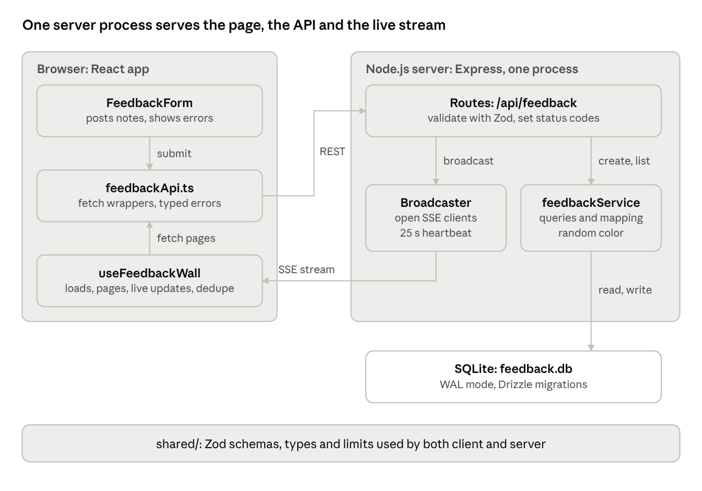

# Feedback Wall — Product & Technical Documentation

Nov 2, 2026

Feedback Wall v0.1 is built, tested and running locally: anyone can post a short note with an optional 1–5 emoji rating, and every visitor sees it appear live on a shared wall.

This pack is the single reference for product, design and engineering. It covers what we are building and why, how it works, how we build and ship it, and what comes next. The engineering source of truth stays in this folder's other docs; this pack summarizes them for the wider team.

| Section | Audience | Answers |
| --- | --- | --- |
| [Product requirements](#product-requirements-prd) | Everyone | What problem, for whom, how we measure success |
| [User stories](#user-stories-and-acceptance-criteria) | Product, QA, engineering | What "done" means for each feature |
| [User workflows](#user-workflows) | Product, design, support | How visitors and organizers move through the app |
| [Technical design](#technical-design) | Engineering | Architecture, data flow, real-time design |
| [API and data model](#api-and-data-model) | Engineering, integrators | Endpoints, payloads, database schema |
| [Security and privacy](#security-privacy-and-abuse-protection) | Engineering, leadership | How a public, anonymous wall is protected |
| [Development workflow](#development-workflow) | Engineering | Setup, commands, review and docs rules |
| [QA and testing](#qa-and-testing) | QA, engineering | Automated coverage and the manual checklist |
| [Deployment and operations](#deployment-and-operations) | Engineering, ops | Hosting, config, releases, backups |
| [Roadmap and risks](#roadmap-risks-and-open-questions) | Everyone | What's next, what could go wrong, open questions |

## Product requirements (PRD)

We are building the lowest-effort way to collect and display feedback in public: no sign-up, one short form, and a wall that updates live for everyone.

### Problem

Event hosts, teams and teachers want quick, visible feedback from a room or an audience. Survey tools are slow to fill in and hide responses from participants. Chat channels bury feedback in conversation and require accounts.

### Target users

| Persona | Need | What they do |
| --- | --- | --- |
| Visitor | Leave feedback in under 30 seconds, no account | Opens the link, writes a note, optionally rates and picks a color |
| Organizer | Watch feedback arrive live and share it on a screen | Shares the wall link, keeps the wall open on a display |

### Goals

1. Posting a note takes one screen and no sign-up.
2. New notes appear for every viewer without a refresh.
3. The wall stays safe to show publicly: no HTML injection, limited spam.
4. The app runs as one small server with no external services.

### Success metrics

| Metric | Target for v1 |
| --- | --- |
| Time from page open to posted note | Under 30 seconds for a first-time visitor |
| Live delivery latency (post to visible on other screens) | Under 1 second on a normal connection |
| Notes rejected by validation or rate limit that were legitimate | Near zero (monitored through support reports) |
| Share of notes with a rating | Tracked as a baseline; no target yet |

Analytics are not built yet, so these are measured manually for now (see Open questions).

### In scope (v1)

- Post a note: message (1–280 characters), optional name (up to 40, default "Anonymous"), optional color (6-color palette, random if omitted), optional 1–5 emoji rating.
- Live character counter, inline validation errors, rate-limit message.
- Wall of sticky-note cards, newest first, with relative times and rating badges.
- Live updates over Server-Sent Events with automatic reconnect and a Live / Reconnecting indicator.
- "Load older notes" pagination, 50 notes per page.
- Rate limit of 5 posts per minute per IP.

### Non-goals (v1)

- Accounts, login, or authentication.
- Editing or deleting notes, by users or admins.
- Replies, reactions, likes, or threads.
- Multiple walls or boards.
- Images, link previews, or rich text.
- Moderation tools or profanity filtering.
- Collecting contact details (email, phone): every note is public.

## User stories and acceptance criteria

All eight stories below are implemented in v0.1 and covered by automated tests or the manual checklist in QA and testing.

| ID | Story | Acceptance criteria |
| --- | --- | --- |
| US-1 | As a visitor, I can post a note without signing up. | Message is required, trimmed, 1–280 characters. Name is optional, up to 40 characters, shown as "Anonymous" if empty. Note appears on the wall and the form clears. |
| US-2 | As a visitor, I can rate my experience. | Five-step emoji scale: Bored, Not good, Okay, Good, Very nice (values 1–5). Optional and clearable. Card shows the emoji and label when rated. |
| US-3 | As a visitor, I can pick a note color. | Six colors plus "Random". If none is picked, the server assigns one at random. |
| US-4 | As a visitor, I see how many characters I have left. | Counter updates on every keystroke, turns amber at 20 or fewer, red when over 280. |
| US-5 | As a visitor, I get clear errors. | Invalid fields show an inline message next to the field. A rejected post because of rate limiting shows "You're posting too fast, try again in a minute." |
| US-6 | As a viewer, I see new notes without refreshing. | A note posted anywhere appears at the top of every open wall within about 1 second. No duplicates appear for the poster. |
| US-7 | As a viewer, I know whether the wall is live. | Indicator shows Connecting, Live, or Reconnecting. After a dropped connection, the wall reconnects and fills in notes posted during the outage. |
| US-8 | As a viewer, I can browse older notes. | Wall loads the newest 50. "Load older notes" fetches the next 50 and disappears when none are left. |

Non-functional requirements:

- Notes are always shown as plain text; HTML in a message is displayed literally.
- Usable on phones (no sideways scrolling at 390 px wide) and with a keyboard (visible focus, labeled fields).
- Text contrast meets WCAG AA on every note color.
- Animations respect the operating system's reduced-motion setting.

## User workflows

Posting is one form and one round trip: the server saves the note and pushes it to every open wall, including the poster's.



The browser checks fields first for instant feedback; the server checks again and also applies the rate limit, so a rejected post comes back as an inline error (400) or the rate-limit message (429).

### Organizer flow

1. Opens the wall link and leaves it on a shared screen or projector.
2. Shares the same link with the audience (chat, slide, QR code).
3. Watches notes and ratings arrive live; the indicator shows Live.
4. After the event, scrolls back with "Load older notes" to review everything.

### Connection drop and recovery

1. The live connection drops (Wi-Fi blip, server restart); the indicator switches to Reconnecting.
2. The browser reconnects automatically after about 3 seconds; if it gives up, the page retries every 5 seconds.
3. On reconnect the page refetches the newest 50 notes and merges them by id, so notes posted during the outage appear without duplicates.
4. The indicator returns to Live.

## Technical design

Feedback Wall is a TypeScript monorepo with three parts — a React client, an Express server and a shared schema package — deployed as one Node.js process backed by a single SQLite file.



The browser posts and fetches over REST and receives new notes over one Server-Sent Events stream; inside the server, routes never touch the database directly but go through the service layer.

### Tech stack

| Layer | Choice | Why |
| --- | --- | --- |
| Language | TypeScript, strict mode | One language and shared types end to end |
| Frontend | React 19 + Vite, Tailwind CSS v4, Montserrat (self-hosted) | Fast builds, simple styling, no third-party font calls |
| Backend | Express 5, helmet, express-rate-limit | Small, well known, async errors handled |
| Real-time | Server-Sent Events (native `EventSource`) | Updates only flow server to browser; plain HTTP, auto-reconnect |
| Database | SQLite via better-sqlite3 + Drizzle ORM | Zero services to run, typed queries, versioned migrations |
| Validation | Zod v4 in `shared/` | One schema validates on both client and server |
| Testing | Vitest + Supertest | Fast unit and API tests against in-memory SQLite |

### Real-time design

- The server keeps an in-memory set of open stream connections. Each new note is written once to every connection as a `feedback.created` event.
- A comment line every 25 seconds keeps proxies from closing idle connections.
- The client adds a note from its own POST response immediately and skips the matching stream event by id, so the poster never sees a duplicate.
- On every (re)connect the client refetches the newest 50 notes and merges by id to fill any gap.

### Key decisions

| Decision | Reason | Trade-off |
| --- | --- | --- |
| SSE instead of WebSockets | One-way updates; no extra library | Bidirectional features later would need a new decision |
| SQLite + one server process | No database server; backups are one file | Cannot scale to several servers without shared pub/sub |
| React + Vite instead of Next.js | Long-lived server with open connections fits a plain Node app | No server-side rendering |
| Cursor pagination by id | Stable while new notes arrive | No jump to an arbitrary page |

Full records live in [`decisions/`](decisions/).

## API and data model

The API has four routes under `/api`, all JSON, all validated by the shared Zod schemas; the full contract lives in [`API.md`](API.md).

### Endpoints

| Method and path | Purpose | Success | Errors |
| --- | --- | --- | --- |
| `GET /api/health` | Liveness check | `200 {"status":"ok"}` | — |
| `GET /api/feedback?limit=&before=` | List notes newest first; `limit` 1–100 (default 50), `before` = cursor id | `200 {items, nextCursor}` | `400` |
| `POST /api/feedback` | Create a note | `201` with the note | `400`, `429` |
| `GET /api/feedback/stream` | Server-Sent Events: `feedback.created` per new note, `: ping` every 25 s | open stream | — |

### Feedback object

```json
{
  "id": 42,
  "message": "Loved the session!",
  "author": "Priya",
  "color": "yellow",
  "rating": 5,
  "createdAt": "2026-11-02T10:15:30.000Z"
}
```

Every error uses one shape: `{"error": {"code", "message", "details"?}}` with codes `VALIDATION_ERROR` (400), `NOT_FOUND` (404), `RATE_LIMITED` (429) and `INTERNAL_ERROR` (500, no internals exposed).

### Database: table `feedback` (SQLite)

| Column | Type | Constraints | Notes |
| --- | --- | --- | --- |
| `id` | INTEGER | Primary key, autoincrement | Also the pagination cursor |
| `message` | TEXT | NOT NULL | 1–280 characters (enforced in Zod) |
| `author` | TEXT | NOT NULL, default 'Anonymous' | Up to 40 characters |
| `color` | TEXT | NOT NULL | One of 6 palette values |
| `rating` | INTEGER | Nullable | 1–5, added in migration 0001 |
| `created_at` | INTEGER | NOT NULL | Unix milliseconds; exposed as ISO `createdAt` |

Schema changes go through Drizzle migrations only (two so far: `0000` creates the table, `0001` adds `rating`). WAL mode is on, so readers never block the single writer.

## Security, privacy and abuse protection

The wall is public and anonymous, so every input is treated as untrusted and validated on the server, whatever the browser already checked.

| Threat | Protection in v1 |
| --- | --- |
| Script injection (XSS) | Notes render as plain text through React. `dangerouslySetInnerHTML` is banned and the linter fails if it appears. |
| Oversized or malformed input | Zod validation on every body and query; JSON body capped at 10 KB; bad JSON returns 400. |
| Spam and flooding | 5 posts per minute per IP (`express-rate-limit`), returning 429 with a friendly message. |
| IP spoofing past the rate limit | Proxy trust is off by default; set `TRUST_PROXY` only when behind a real reverse proxy. |
| Leaking internals | 500 errors return a generic message; details go to server logs only. |
| Browser attacks | `helmet()` security headers including a strict Content Security Policy. No CORS: client and API share one origin. |

Privacy: we collect only what a visitor types (message, optional name, color, rating) plus a timestamp. No accounts, cookies, emails or phone numbers. IP addresses are held in memory for rate limiting only and never stored.

Accepted gaps for v1:

- No way to remove an abusive note except a database script.
- No profanity or spam filtering.
- No cap on open live connections per IP.

These must be closed before the wall is promoted to large public audiences (see Roadmap).

## Development workflow

A new engineer goes from clone to a running wall with two commands: `npm install` then `npm run dev`, which opens on http://localhost:5173.

### Commands

| Command | What it does |
| --- | --- |
| `npm install` | Installs all three workspaces (client, server, shared) |
| `npm run dev` | Builds shared, applies migrations, runs shared watch + server (port 3001) + Vite client (port 5173) |
| `npm test` | Runs Vitest in server and client |
| `npm run lint` | ESLint across the repo |
| `npm run format` | Prettier formatting |
| `npm run build` | Builds shared, server and client for production |
| `npm start` | Runs the production server (serves API and built client) |
| `npm run db:generate` | Creates a migration from schema changes |
| `npm run db:migrate` | Applies pending migrations |

### Making a change

1. Branch from `main` with a short name, for example `feat/note-reactions`.
2. Read the relevant file in `docs/` before touching an area (`CLAUDE.md` maps which doc covers what).
3. Change shared Zod schemas first when a request or response shape changes; client and server follow from them.
4. Schema changes: edit `server/src/db/schema.ts`, run `db:generate`, review the SQL, run `db:migrate`. Never edit the database file by hand.
5. Add tests next to the code (`thing.test.ts`); every API route needs success and main error cases.
6. Run `npm test`, `npm run lint` and `npm run build` before opening a pull request.
7. Update docs in the same pull request when the change is significant (below).
8. Small, focused commits, for example `feat: add load-older pagination`.

### When docs must be updated

| Change | Update |
| --- | --- |
| User-facing feature added or changed | `PRODUCT.md` + `CHANGELOG.md` |
| API route, payload, status code or SSE event | `API.md` |
| Database schema or migration | `DATABASE.md` |
| Library, tool or service added or swapped | `TECH_STACK.md` |
| Folder structure, data flow, deployment | `ARCHITECTURE.md` |
| Validation or rate limits | `SECURITY.md` |
| Hard-to-reverse decision | New record in `docs/decisions/` |

Bug fixes, refactors, styling tweaks and test-only changes do not need doc updates.

### Code review checklist

- [ ] User content is never rendered as HTML
- [ ] Server validates input with the shared schema
- [ ] No new dependency without a `TECH_STACK.md` entry
- [ ] API changes reflected in `API.md`
- [ ] Tests added and passing; lint and build clean

## QA and testing

The v0.1 build passes 42 automated tests (34 server, 8 client), lint, type-checks and a production build, plus a scripted browser check of the live flow.

### Automated coverage

| Area | Tool | What is covered |
| --- | --- | --- |
| API routes | Vitest + Supertest, in-memory SQLite | Health; create with defaults; message, name, color and rating limits; malformed JSON; plain-text storage; unicode and emoji; 429 on the 6th post; pagination and cursors; invalid query params; 404 shape |
| Live stream | Vitest, real HTTP server | `feedback.created` delivered over SSE after a POST |
| Broadcaster | Vitest, fake timers | Fan-out, removal, heartbeat only while clients are connected, dropping broken clients |
| Client logic | Vitest | Dedupe-by-id merge, relative time formatting, stable card tilt |

### Manual release checklist

Run against a production build before each release.

- [ ] Post a note with name, color and rating; it appears with the rating badge and the form clears
- [ ] Open a second window; a note posted in one appears in the other within about 1 second
- [ ] Stop and restart the server; indicator shows Reconnecting, then Live, and notes posted meanwhile appear
- [ ] Post 6 notes within a minute; the 6th shows the rate-limit message
- [ ] Post `<script>alert(1)</script>`; it shows as plain text
- [ ] Message over 280 characters shows the counter in red and an inline error
- [ ] "Load older notes" appears after 50 notes and fetches the next page
- [ ] Phone width (390 px): no sideways scrolling; keyboard-only: every control reachable with visible focus
- [ ] Browser console shows no errors

## Deployment and operations

Production is one Node.js process on a host with a persistent disk, serving both the API and the built page on a single port behind HTTPS.

### Hosting requirements

- A long-running Node.js server (current LTS) with a mounted persistent volume for the SQLite file: for example Railway, Fly.io, Render with a disk, or a VPS.
- Not suitable: serverless functions (Vercel, Netlify), because the database file and open live connections need a long-lived process.
- HTTPS in front of the app; the security policy upgrades all requests to HTTPS.
- Exactly one instance. A second instance would not see the first one's live connections.

### Configuration

| Variable | Default | Production value |
| --- | --- | --- |
| `PORT` | 3001 | The host's assigned port |
| `DATABASE_PATH` | `./data/feedback.db` | A path on the mounted volume |
| `NODE_ENV` | development | `production` (turns on serving the built page) |
| `TRUST_PROXY` | 0 | Number of reverse proxies in front, usually 1 |

### Release process

1. Merge to `main` after review, with tests, lint and build green.
2. Run the manual release checklist against a production build.
3. Add the release's user-facing changes to `CHANGELOG.md`.
4. On the host: `npm install`, `npm run build`, `npm run db:migrate`, then `npm start`.
5. Smoke check: `GET /api/health` returns ok, post one note, confirm it appears live.

### Backups and monitoring

- Back up with SQLite's online backup (`sqlite3 feedback.db ".backup backup.db"`), never by copying the file mid-write. Suggested cadence: daily, keeping 7 days.
- Point an uptime monitor at `GET /api/health`.
- Make sure the reverse proxy does not buffer `/api/feedback/stream`, or live updates will stall.

## Roadmap, risks and open questions

The next priority is moderation: v1 cannot remove an abusive note without a database script, which blocks promoting the wall to large public audiences.

### Roadmap (proposed, not yet scheduled)

1. **Launch v1** — deploy to a host with a persistent disk, set up HTTPS, backups and an uptime check; run the release checklist.
2. **Safety** — an organizer-only way to hide or delete notes, a basic profanity filter, and a cap on live connections per IP.
3. **Insight** — a simple organizer summary: note count, rating distribution, and export to CSV.
4. **Engagement** — reactions on notes and a full-screen "presenter" mode for projecting the wall.
5. **Scale** — multiple walls with their own links; this needs authentication for organizers and a decision record on data model changes.

### Risks

| Risk | Likelihood | Impact | Mitigation |
| --- | --- | --- | --- |
| Abusive or offensive notes on a projected wall | Medium | High | Phase 2 moderation; until then, keep links to trusted audiences |
| Spam from many IPs bypasses the per-IP limit | Low | Medium | Monitor volume; add filtering or a challenge if it appears |
| Host without a persistent disk loses all notes on redeploy | Medium | High | Hosting checklist; daily backups |
| Reverse proxy buffers the live stream, so updates stall | Medium | Medium | Release smoke check; `X-Accel-Buffering: no` header already sent |
| Growth past one server process | Low | Medium | Documented limit; would need shared pub/sub (e.g. Redis) and a decision record |
| Dev-tool security warnings (drizzle-kit, eslint) | Low | Low | Affect tooling only, not the running app; recheck on upgrades |

### Open questions

- [ ] Who owns moderation, and how quickly must an abusive note be removed?
- [ ] Which host do we deploy to, and who holds the account?
- [ ] Do we want product analytics, and which privacy-friendly tool?
- [ ] Should organizers be able to export notes after an event?
- [ ] Is the 5-posts-per-minute limit right for a busy room sharing one network (same public IP)?
