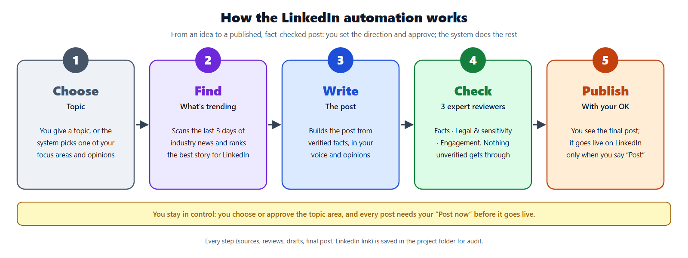

# LinkedIn Automation (vi-writer)

An agentic system built on Claude Code that researches, writes, reviews and (with explicit approval) publishes evidence-based LinkedIn posts in the AI / AI Product Management niche.



## Start here
- **Solution overview** (purpose, steps, triggers, architecture): [docs/linkedin-automation-solution-overview.docx](docs/linkedin-automation-solution-overview.docx)
- **Technical design document:** [docs/vi-writer-technical-design.docx](docs/vi-writer-technical-design.docx)
- **All prompts and descriptions:** [docs/vi-writer-prompts-and-descriptions.docx](docs/vi-writer-prompts-and-descriptions.docx)
- **Diagrams:** [architecture](docs/architecture.png) · [complete workflow](docs/vi-writer-workflow.png)
- **Source research:** [anatomy-of-an-ai-post.html](anatomy-of-an-ai-post.html)

## Usage (in Claude Code, from this folder)
```
/vi-writer <topic | domain>        # e.g. /vi-writer genai is good for finance
/vi-writer                         # no input: uses a focus area from my-views.md
/vi-writer <topic> --no-trend      # skip trend search
/review-panel <post file or text>  # run the 3 reviewers on any post
```

## Layout
| Path | Contents |
|---|---|
| `.claude/skills/vi-writer/` | Orchestrator skill, reference rules, Python check scripts |
| `.claude/skills/review-panel/` | Review panel skill |
| `.claude/agents/` | trend-captain, fact-checker, compliance, editorial |
| `my-views.md` | Author's focus areas, opinions, voice |
| `posts/` | Final posts with status / URL / thesis front matter |
| `research/` | One folder per run: trend scan, sources, analysis, drafts, reviews, publish logs; `INDEX.md`, `backlog.md` |
| `docs/` | Design documents and diagrams |
| `tools/docgen/` | Scripts that regenerate the diagrams and Word documents |

## Regenerating the documents
```
cd tools/docgen && npm install
python make_workflow.py && python make_diagrams2.py   # diagrams (needs Chrome for PNG export)
node build.js && node build_solution.js               # Word documents
```
Note: the generators were written for this machine's paths (`C:\Users\PRAVIN\Desktop\LinkedInAutomation`); adjust `P`/`D` at the top of each file if the project moves.
