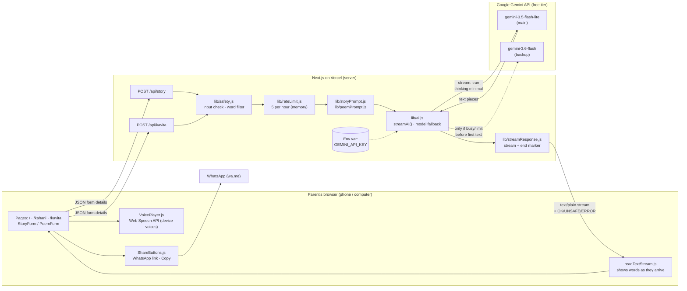
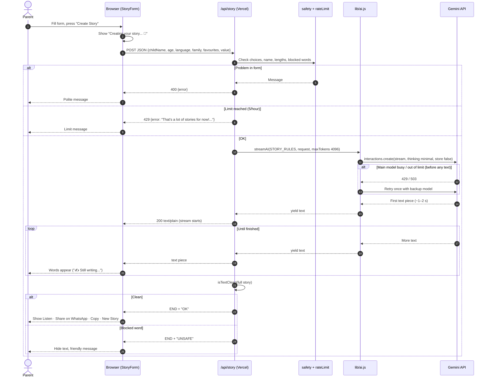
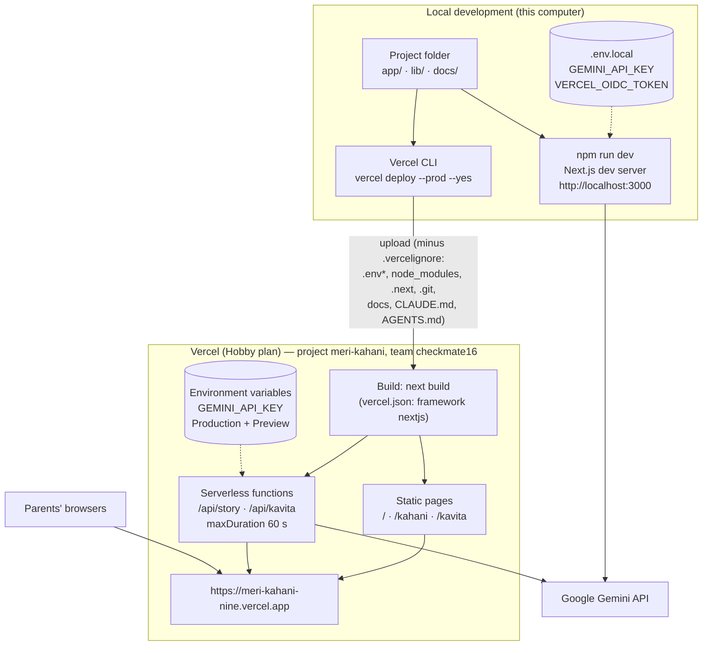

# Architecture — Meri Kahani

Diagrams use Mermaid (they render on GitHub and in many Markdown viewers). They describe the system as built on 2026-11-03.

---

## 1. System architecture

**Key points**
- The browser never sees the API key; only the server calls Gemini.
- No database: nothing is saved. The usage limit keeps only addresses and times, in memory.
- `lib/ai.js` is the single switch point to change the AI provider.
- Voice runs entirely in the browser using the device's own voices.

---

## 2. Sequence: creating a story

The poem flow is the same, using `/api/kavita`, `POEM_RULES` and `maxTokens 1536`.

---

## 3. Deployment: local development vs Vercel production

| | Local | Production |
|---|---|---|
| Start | `npm run dev` | `vercel deploy --prod --yes` |
| URL | http://localhost:3000 (or the Network address on the same Wi-Fi) | https://meri-kahani-nine.vercel.app |
| Key comes from | `.env.local` | Vercel environment variables |
| Usage limit memory | One process; resets on restart | Per server copy (approximate) |
| Git | Not needed for deploy | Not connected (Planned: GitHub auto-deploy) |
