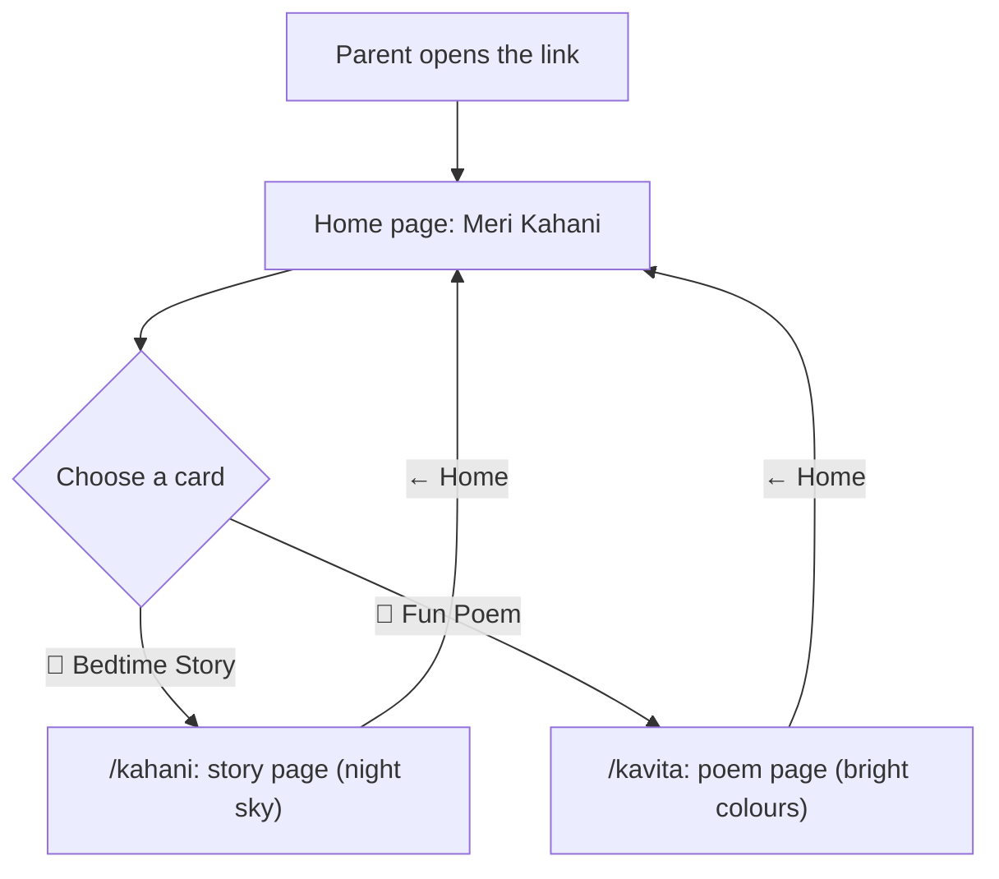
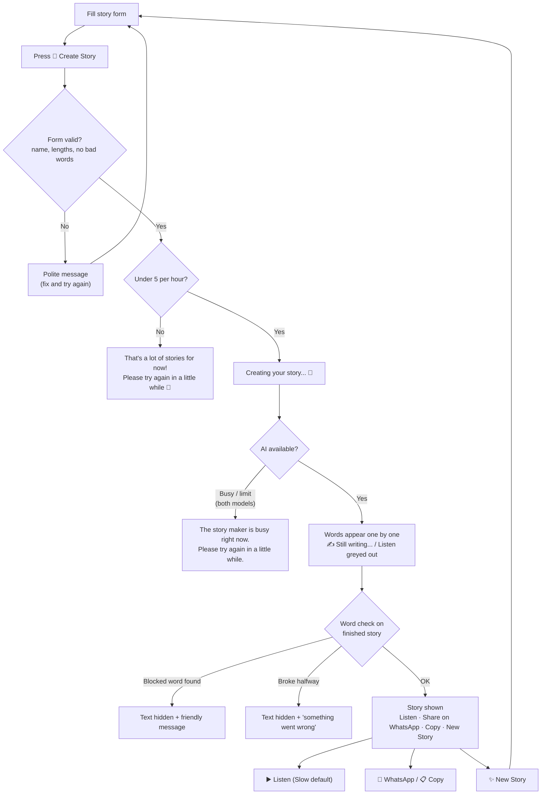
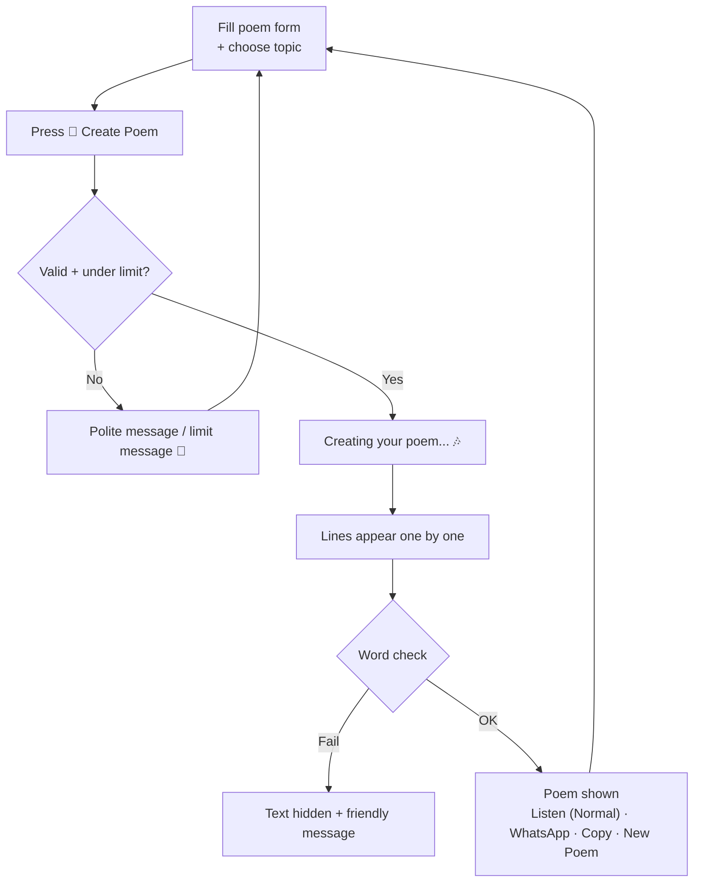
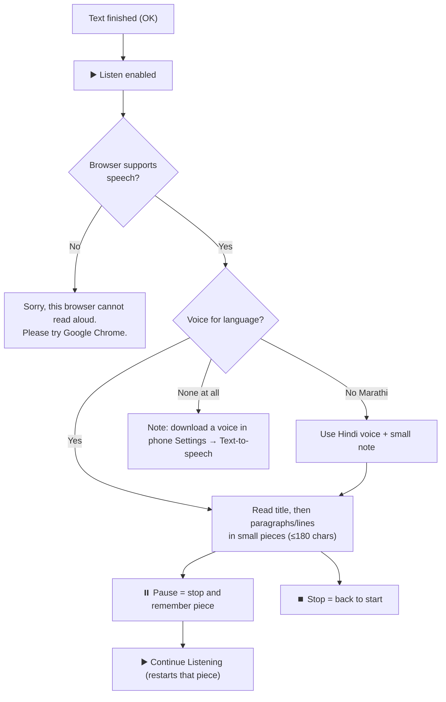

# User Flows — Meri Kahani

Step-by-step journeys as built on 2026-11-03. All screen text is in simple English;
only the story or poem itself uses the chosen language.

---

## 1. Entry: Home page (`/`)

1. Parent opens the link (for example from WhatsApp) on a phone or computer.
2. Sees the moon, "Meri Kahani" and "What shall we make today? ✨".
3. Chooses one of two big cards:
   - **📖 Bedtime Story** ("A calm story for sleep 🌙") → `/kahani`
   - **🎉 Fun Poem** ("A rhyming poem to play with 🎶") → `/kavita`
4. Footer on every page: "🔒 We don't save your child's details."

---

## 2. Story journey (`/kahani`)

1. **Fill the form**
   - Child's name (required; letters only; max 30)
   - Age (2–10; default 5)
   - Language: English (default) / Hindi / Marathi
   - Family members or pet names (optional; max 100)
   - Favourite things (max 100)
   - Value to teach: Sharing (default), Honesty, Courage, Kindness, Being brave at night, Listening to elders
2. **Press "🌙 Create Story".** The button changes to "Creating your story..." and is disabled.
3. **Checks on the server, before any AI call:**
   - Choices must be valid (age, language, value).
   - Name, lengths and blocked words → if a problem, a polite message (for example "Please use kind words. This is for young children. 🙏").
   - Usage limit (5 per hour) → if reached: "That's a lot of stories for now! Please try again in a little while 🌙".
4. **Waiting:** "Creating your story... 🌙" shows until the first words arrive (measured ~1–2 s).
5. **Writing:** the title and paragraphs grow word by word. Below: "✍️ Still writing..." and a greyed-out
   "▶️ Listen (when the story is finished)".
6. **Finished:** the server's word check runs on the full text.
   - **Passed** → the story stays. **▶️ Listen**, Pause, Stop, Speed (Slow default / Normal),
     **💬 Share on WhatsApp**, **📋 Copy** and **✨ New Story** appear.
   - **Failed** → the text is hidden: "Sorry, we couldn't create a good story this time. Please try again. 🌙"
   - **Broke halfway** → the text is hidden: "Sorry, something went wrong while writing. Please try again."
7. **Listen:** the voice matches the language (en-IN / hi-IN / mr-IN). If there's no Marathi voice, the Hindi voice is used with a note.
8. **Share:** WhatsApp opens with the title, the first lines and the page link. Copy copies the full story ("Story copied ✓").
9. **New Story:** clears the story, scrolls to the form, and keeps all details filled in.

---

## 3. Poem journey (`/kavita`)

Same steps as the story, with these differences:

| | Story | Poem |
|---|---|---|
| Look | Calm night sky, moon, stars | Bright yellow/orange/green, 🎈🌈🎶 |
| Extra field | Value to teach | "What should the poem be about?" Animals (default), Rain, Train, Food, Festivals, Playing outside, Surprise me |
| Button | 🌙 Create Story | 🎉 Create Poem |
| Waiting text | Creating your story... 🌙 | Creating your poem... 🎶 |
| Output | 450–600 words, paragraphs | 3–4 verses × 4 lines, shown line by line, centred |
| Voice speed default | Slow | Normal |
| New button | ✨ New Story | ✨ New Poem |
| Limit message | "...a lot of stories for now!... 🌙" | "...a lot of poems for now!... 🎉" |

The usage limit is **shared**: 5 stories and poems together per hour.

---

## 4. Listen (voice) flow

